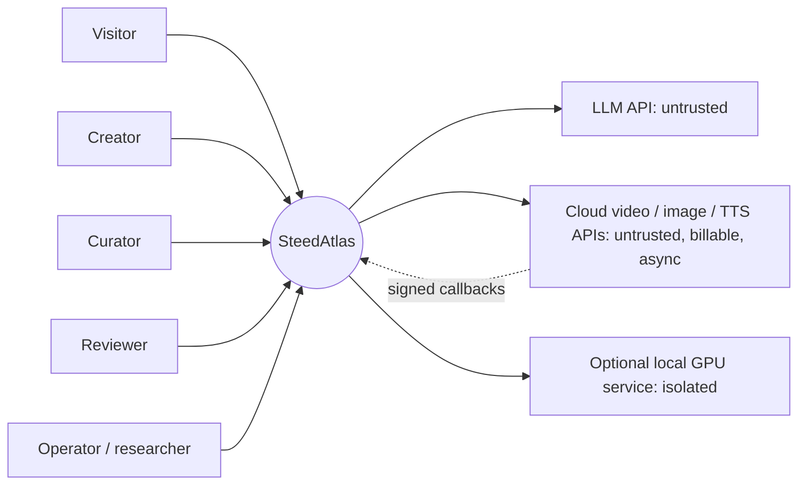
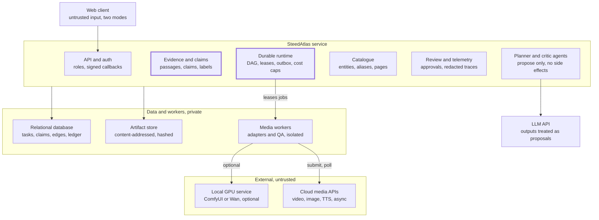
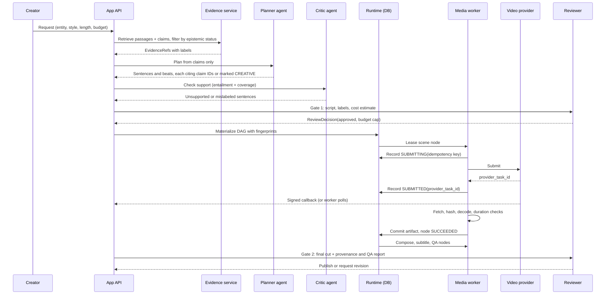

# SteedAtlas — Architecture Research Report: Knowledge-Grounded Agentic Multimedia Systems

Oct 31, 2026 · @hgsrbdh

## 1. Executive synthesis

**Recommendation:** evolve SteedAtlas into a *modular monolith with a database-backed durable task runtime*, a claim-level provenance store, and video generation behind replaceable, isolated adapters. The research core is the evidence-to-artifact provenance graph and the recovery runtime. The video models are not the core. Confidence: moderate (conceptual design, not empirically tested).

**Product position.** An evidence-first cultural media studio. Visitors explore curated entries, ask grounded questions with inspectable citations, and can commission short narratives. Every sentence, scene and clip can be traced back to a source passage, or is visibly labeled as creative interpretation.

**Principal research question.** Can claim-level evidence links, shared by the knowledge layer and the execution runtime, (a) cut wasted paid media calls after edits and partial failures without unsafe reuse, and (b) lower the rate of unsupported historical assertions in generated scripts and scenes, compared with dependency-only caching and citation-free generation?

**What is established versus what is new.** Most of the machinery is standard practice and should be presented that way:

- Durable execution and replay (Temporal, LangGraph checkpointers).
- Hash-keyed resume (Nextflow, Bazel).
- Staleness from upstream data versions (Dagster).
- Minimal rebuilds (the build-systems literature).
- Provenance vocabularies (W3C PROV, C2PA).

The narrow, testable addition is to make **claim validity and source epistemic status** first-class inputs to invalidation and recovery decisions across text, image, audio and video artifacts. A second addition is to evaluate that choice against strong caching baselines. Whether this beats simple content-hash caching is an open question. It may not.

**Target architecture (Alternative A+).**

- One Python service with explicit modules: Catalogue, Evidence, Planner, Runtime, Media Adapters, Review, Telemetry.
- One relational database holds task state, provenance edges and the outbox.
- Lease-based worker processes run long and billable media work.
- A content-addressed object store holds artifacts.
- Two decision-making agent roles (narrative planner, factuality critic). Everything else is a typed, deterministic tool.

**Fallback (Alternative C-lite).** Keep the same contracts but move orchestration onto an external durable-execution engine. Trigger it if the in-house runtime fails the fault-injection suite (Section 13) on duplicate side effects or lost work, or if engineering time for the runtime exceeds an agreed budget. A framework-assisted agent graph (Alternative B, e.g. LangGraph) remains a **comparison baseline**, not the system of record.

**Most important trade-offs.**

- Owning the runtime gives full provenance and selective-replay control, which the research needs. The cost is reimplementing durability semantics that mature engines already provide.
- Fewer agents means lower cost, latency and coordination failure. The cost is less "agentic" theater. Public evidence ([MAST](https://arxiv.org/abs/2503.13657)) suggests multi-agent gains are often small.
- Cheap deterministic media checks are reproducible but say nothing about aesthetics, so human review stays in the loop.

**Five highest-risk unknowns.**

1. Whether claim-aware invalidation saves anything beyond plain content-hash caching on realistic edit patterns (Track A's central falsifier).
2. Whether the curated source base is strong enough for most catalogue entries to support grounded narratives. Uniform coverage is unlikely.
3. Provider semantics. Async video APIs differ in idempotency, expiry, retry and billing-on-failure behavior. This is unknown until each provider's documentation is reviewed.
4. Whether automated entailment and critic checks agree with blinded expert judgment on historical-versus-literary distinctions in the source language.
5. Rights to source digitizations, music and voice, and output terms of the chosen video models. These may constrain the demo more than any technical issue.

## 2. Scope, method and evidence conventions

This is a desk study of public sources, accessed on 2026-10-31. It describes a hypothetical platform and makes no claims about any real codebase.

**Boundaries honored.**

- No private repository, account, deployment, credential or user data was requested or accessed.
- No code was written for deployment, installed or executed against any application.
- No paid model call or media job was launched.
- Third-party projects were consulted only through public release pages, READMEs, documentation and license texts.
- The starting-point assumptions (about 100 entities, lexical retrieval, Python API, external video adapters, a conceptual multi-agent UI) are treated as hypotheticals. Anything that depends on them is marked *conditional*.

**Evidence grades** (from the dossier).

| Grade | Meaning |
| --- | --- |
| A | Peer-reviewed paper, standard, or primary specification |
| B | Official project documentation or release notes |
| C | Public project claim, blog or secondary report without independent validation |
| D | Inference or explicit hypothesis by this study |

**Maturity labels** for recommendations: *Established prior art*, *Conceptual design*, *Plausible hypothesis*, *Empirically supported* (none in this report), *Unknown*.

**Dating conventions.**

- Release dates on GitHub release pages appear without a year when they fall in the current year. Those dates are read as 2026, which is an inference (grade B/D).
- The Pixelle-Video README was read through a public mirror of the upstream repository (the upstream page could not be fetched). Its contents are graded C until checked against the AIDC-AI original.
- Stars and popularity were deliberately not used as evidence of quality or maintenance.

**What this report cannot claim.** It has no benchmark results, integration compatibility findings, production readiness, or cost figures for any real provider. Where a number appears, it is a published third-party figure, cited, or a design parameter to be set later.

## 3. Literature and prior-art landscape

Every mechanism SteedAtlas needs already exists in some adjacent field. The research question is what changes when those mechanisms meet claim-level evidence and expensive, nondeterministic media tools.

| Problem | Key prior art | Mechanism | Limitation for SteedAtlas | Grade | Role |
| --- | --- | --- | --- | --- | --- |
| Durable long-running execution | [Temporal Activities](https://docs.temporal.io/activities) | Event history plus replay. Completed activities are not re-run on replay. Activities should be idempotent. | Durability does not make external side effects exactly-once. Idempotency stays the caller's job. | B | Design reference; fallback engine |
| Checkpointed agent graphs | [LangGraph durable execution](https://docs.langchain.com/oss/python/langgraph/durable-execution), [checkpointers](https://docs.langchain.com/oss/langgraph/checkpointers), [interrupts](https://docs.langchain.com/oss/python/langgraph/interrupts/index.html) | Per-superstep checkpoints. Pending writes from successful nodes are kept, so they are not re-run. `interrupt()` pauses for human input. | Resume restarts the interrupted *node*, so side effects inside it must be split into tasks or made idempotent. Provenance is state snapshots, not claim lineage. | B | Comparison baseline (S/R tracks) |
| Compensation for partial failure | [Sagas, Garcia-Molina & Salem 1987](https://www.cs.princeton.edu/research/techreps/598) | Each step has a compensating action. Runs either complete or are compensated. | A paid generation cannot be "refunded". Compensation is mostly bookkeeping plus cleanup. | A | Established pattern |
| Safe retry of billable calls | [Stripe idempotent requests](https://docs.stripe.com/idempotency) | Server stores the first result per key and rejects mismatched parameters. Keys are pruned after at least 24 h. | Only helps when the provider supports keys. Many media APIs may not (unknown per provider). | B | Contract pattern |
| Minimal recomputation | [Build Systems à la Carte (ICFP 2018 / JFP 2020)](https://www.microsoft.com/en-us/research/publication/build-systems-a-la-carte/) | Defines *minimality*: run only tasks that transitively depend on changed inputs. Separates scheduler from rebuild strategy. | Assumes deterministic tasks. Generative tasks break "same input, same output". | A | Formal anchor for Track A |
| Hash-keyed workflow resume | [Nextflow cache and resume](https://nextflow.io/docs/edge/cache-and-resume.html) | Task hash over inputs and script. Resume needs a cache hit *and* outputs still present. | File hash uses path, size and mtime by default, so it over-invalidates. No semantic or claim awareness. | B | Baseline R2 |
| Staleness from upstream data | [Dagster asset observations / data versions](https://docs.DAGster.io/concepts/assets/asset-observations) | Downstream assets are flagged when upstream data versions or code versions change. | Flags staleness. Does not decide *safe reuse* under partial semantic change. | B | Closest prior art for Track A |
| Provenance vocabulary | [W3C PROV-O (2013)](https://www.w3.org/TR/2013/REC-prov-o-20130430/) | Entity / Activity / Agent with `wasDerivedFrom`, `wasGeneratedBy`, `used`. | Vocabulary only, no invalidation semantics. | A | Export format for lineage |
| Media provenance | [C2PA 2.2](https://spec.c2pa.org/specifications/specifications/2.2/specs/C2PA_Specification.html) | Signed manifests bind assertions to assets. Edits append to provenance. | Says who did what to an asset, not whether its historical claims are supported. | A | Optional output labeling |
| Cultural-heritage modeling | [CIDOC CRM / ISO 21127:2023](https://cidoc-crm.org/node/202) | Event-centric ontology for objects, actors, places, periods, interpretations. | Heavy for about 100 entities. Mapping to it is more useful than storing in it. | A | Mapping target, not storage |
| Retrieval baselines | [BEIR (NeurIPS 2021)](https://arxiv.org/abs/2104.08663v1) | 18-dataset zero-shot study. BM25 is a robust baseline. Dense models often underperform out of domain. | General web/biomed corpora, not small curated heritage catalogues. | A | Motivates B1 BM25 as a strong baseline |
| Hybrid fusion | [Reciprocal Rank Fusion (SIGIR 2009)](https://plg.uwaterloo.ca/~gvcormac/cormacksigir09-rrf.pdf) | Sum of 1/(k + rank) across rankers, no score calibration. | Gains depend on ranker diversity, which may be small at this scale. | A | Baseline B3 |
| Citation quality | [ALCE (EMNLP 2023)](https://arxiv.org/abs/2305.14627v2) | Automatic metrics for fluency, correctness and citation quality. | English QA corpora. Citation support differs from historical truth. | A | Metric design |
| Atomic factuality | [FActScore (EMNLP 2023)](https://aclanthology.org/2023.emnlp-main.741) | Decompose text into atomic facts and score the share supported by a knowledge source. | Precision-only. Abstention inflates scores. Depends on the knowledge source. | A | Claim decomposition for Track B |
| Multi-agent reliability | [MAST (NeurIPS 2025 D&B)](https://arxiv.org/abs/2503.13657v2) | 14 failure modes from 1,642 annotated traces. Many failures stem from system design. | Benchmarks are coding/maths/agents, not media production. | A | Supports the minimal-agent stance |
| Cost-aware model use | [FrugalGPT](https://arxiv.org/abs/2305.05176) | LLM cascades stop at the cheapest model whose output passes a scorer. | Text tasks with cheap scorers. Media acceptance is costlier to judge. | A | Prior art for Track A's H3 |
| Video quality evaluation | [VBench (CVPR 2024)](https://openaccess.thecvf.com/content/CVPR2024/html/Huang_VBench_Comprehensive_Benchmark_Suite_for_Video_Generative_Models_CVPR_2024_paper.html) | 16 disentangled dimensions with human-preference validation. | Built to compare models, not to gate a single production clip. Compute-heavy. | A | Optional media metrics |
| Retrieved-content attacks | [Indirect prompt injection (Greshake et al. 2023)](https://arxiv.org/abs/2302.12173v2) | Retrieved data can act as instructions and steer tool calls. | General finding. Heritage corpora are curated but may include scraped text. | A | Threat model input |

**Reading of the landscape.** Durable execution, idempotency, minimal rebuilds, staleness tracking and provenance vocabularies are mature. Retrieval research warns against assuming dense retrieval helps a small curated corpus. Multi-agent research warns against assuming more agents add reliability. The open space is the joint treatment of claims, epistemic status and paid nondeterministic media under one invalidation and recovery semantics. That space should be claimed modestly and tested against strong baselines.

## 4. Architecture alternatives

At research-scale volume, a modular monolith with a database-backed durable runtime (A+) is preferred. It keeps provenance and selective replay inside code the researcher controls, at the lowest operational cost. Four alternatives were compared on the dossier's ten criteria. Weights are argued, not measured.

**Criteria weights (argued).**

- *Reliability/recoverability* (15%) and *provenance/factuality* (15%) carry the research question.
- *Inspectability/reproducibility* (12%) and *scientific distinctiveness* (12%) decide whether results are publishable.
- *Migration effort* (10%), *license/integration risk* (8%), *low-volume cost* (8%) and *operational simplicity* (8%) reflect a small team.
- *End-user experience* (7%) and *latency/parallelism* (5%) matter less at research scale, because clips are generated in minutes, not milliseconds.

| Criterion (weight) | A+ Modular monolith + DB-backed durable runtime | B Framework-assisted agent graph (e.g. LangGraph) | C Event-driven durable service (external engine or event sourcing) | D Video-pipeline-dominant (delegate to MoneyPrinterTurbo/Pixelle-like platform) |
| --- | --- | --- | --- | --- |
| Reliability & recoverability (15) | Medium-High. Depends on correctly implementing leases, outbox and reconciliation | Medium-High. Mature checkpoints; node-level replay requires splitting side effects | High. Strongest durability semantics | Low-Medium. Recovery semantics are the platform's, partly opaque |
| Provenance & factuality (15) | High. Claim edges are native | Medium. State snapshots, claim lineage must be added beside them | High, if events carry claim IDs | Low. Script-to-scene lineage not modeled |
| Inspectability & reproducibility (12) | High | Medium. Framework internals in the loop | Medium. More moving parts | Low |
| Scientific distinctiveness (12) | High. The runtime *is* the experiment | Medium. Risk that results describe the framework | Medium-High | Low. Mostly integration |
| Migration effort (10) | Low-Medium. Evolves the hypothetical existing Python backend | Medium | High | Medium. Fast start, painful later |
| License & integration risk (8) | Low | Low (MIT) | Low-Medium. Depends on engine and hosting | Medium. MIT/Apache code, but provider, music and stock-media terms vary |
| Low-volume cost (8) | Low | Low | Medium. Extra infrastructure | Low-Medium |
| Operational simplicity (8) | High. One service, one database, workers | Medium | Low | Medium |
| End-user experience (7) | Medium. UI built in-house | Medium | Medium | High at first. Polished defaults |
| Latency & parallelism (5) | Medium | Medium | High | Medium |

**Worst failure modes.**

- **A+:** subtle bugs in home-grown durability (double submit after crash, lost lease). Mitigate with the fault-injection suite in Section 13 before any paid pilot.
- **B:** bugs relocate into adapters, and claim lineage drifts from framework state. Replay semantics change with framework releases; for example, the [langgraph 1.2.x](https://github.com/langchain-ai/langgraph/releases) notes list several resume and replay fixes through October 2026.
- **C:** operational overhead dominates a small project. Event-ordering and versioning discipline is required.
- **D:** the system becomes a wrapper. The core research question disappears.

**Decision triggers.**

- Stay on **A+** while it passes the fault-injection suite with zero duplicate billable submissions and zero lost completed artifacts across all seeds.
- Move orchestration to **C** if A+ fails those invariants after one hardening cycle, or if concurrency needs exceed one database plus a few workers.
- Use **B** only as baseline S2/R1 in experiments. Adopt it as the runtime only if it matches A+ on recovery correctness *and* claim lineage can be kept outside it without duplication.
- Use **D** components only as isolated adapters or as a *baseline* production pipeline for media-quality comparison.

**Boundaries that stay stable across all options.**

- The Evidence/Claim store and its API.
- The TaskNode and Artifact contracts (Section 6).
- The media-adapter interface (submit, poll or callback, fetch, verify).
- The review-decision record.
- The telemetry schema.

These are the parts that make results comparable whichever orchestrator runs underneath. The **true research core** is the claim graph plus the invalidation and recovery policy. Video generation, TTS, subtitle alignment, scene detection and even the orchestrator can be swapped for third-party capabilities without changing the scientific question.

## 5. Proposed target architecture and fallback

The target has one trusted Python service and one relational database. Lease-based media workers sit on a private network. Every external model, whether LLM or media, sits outside the trust boundary: its output is a *proposal* that deterministic code must validate before anything is committed. Maturity: conceptual design.

### 5.1 System context (C4 level 1)



### 5.2 Containers and trust boundaries

*Diagram: Claims and runtime are the core; providers stay outside (container view · 3 trust zones, 13 parts). Rendered in Mermaid here because the doc's drawn diagram doesn't carry over to Markdown; the boxes, labels and arrows are the same.*



Dashed borders are trust boundaries. Only the service writes to the database. Workers hold leases and touch providers. Nothing returned by an LLM or media provider is committed until a deterministic check accepts it. The two accented parts, claims and runtime, are the research core; every other part is replaceable.

### 5.3 Which responsibilities are agentic

Only two roles need open-ended judgment. Everything with money, irreversibility or a checkable answer is a typed tool.

| Responsibility | Assigned to | Rationale |
| --- | --- | --- |
| Narrative planning (outline, script, storyboard from approved claims) | **Planner agent** | Open-ended semantic and stylistic choices |
| Factuality critique of script and beats | **Critic agent** (different prompt, ideally a different model) plus deterministic coverage check | Semantic judgment; separate model reduces self-grading |
| Evidence retrieval | Tool (BM25 + alias table; hybrid only if Section 13 justifies it) | Deterministic and testable |
| Claim extraction from sources | Curator, with LLM-proposed drafts | Editorial truth is a human decision |
| Media prompt construction | Deterministic template from beat + identity constraints; LLM phrasing optional and logged | Reproducibility; identity consistency |
| Video, image, TTS generation | Tool (provider adapter) | Billable external side effect |
| ASR alignment, subtitles, composition | Tool | Deterministic |
| Decode, duration, silence, scene-cut checks | Tool | Cheap objective QA |
| Retry vs fallback vs abandon | Deterministic policy; an agent may *recommend* | Spends money |
| Approval, publication, deletion | Human decision, enforced by code | Never authorized by model text |
| Cost accounting and caps | Tool | Must be exact |

Adding a third agent, such as a separate "media-quality reviewer", is justified only if the S-track ablation in Section 13 shows a cost-adjusted gain over S1. Without that gain, the extra role is coordination overhead.

### 5.4 End-to-end sequence: evidence-grounded creation



### 5.5 Partial failure, cancellation and selective recovery

```mermaid
sequenceDiagram
  participant RT as Runtime
  participant A as Worker A
  participant B as Worker B
  participant P as Provider
  participant U as Creator
  A->>RT: lease(scene-2) + heartbeats
  A->>RT: SUBMITTING(key K2)
  A->>P: submit
  P-->>A: task t-77
  A->>RT: SUBMITTED(t-77)
  Note over A: process crashes
  RT->>RT: lease expires
  RT->>B: lease(scene-2), attempt 2
  B->>RT: read SUBMITTED(t-77)
  B->>P: poll t-77 (no resubmit)
  P-->>B: FAILED (content check)
  B->>RT: scene-2 FAILED_RETRYABLE; scenes 1 and 3 stay SUCCEEDED
  RT->>U: Gate: retry scene-2 at estimated cost, or still-image animatic fallback
  U-->>RT: approve fallback
  RT->>B: run animatic node for scene-2 only
  U->>RT: edit claim C14 (date corrected)
  RT->>RT: invalidate closure(C14): sentence s7, caption, TTS line; scene-3 clip reused
  RT->>B: re-run TTS line, subtitles, composition only
  U->>RT: cancel job
  RT->>RT: CANCEL_REQUESTED; late callbacks recorded but ignored
```

### 5.6 Framework-independent core and an optional framework-assisted variant

**Framework-independent (recommended).** The runtime is a set of database tables (tasks, attempts, leases, outbox, artifacts, edges, ledger), a scheduler loop and stateless workers. Correctness rests on three things: atomic state transitions written in the same transaction as outbox rows, idempotency keys derived from node fingerprints, and reconciliation against providers before any resubmission.

**Framework-assisted variant (baseline).**

- Planner and critic run as nodes of a LangGraph graph with a Postgres checkpointer.
- Approval gates use `interrupt()`. Per LangGraph's docs, it saves state and waits indefinitely for a resume value.
- Billable media nodes are *not* moved into the framework. They stay in the runtime above, invoked as tasks, so that claim lineage and selective replay remain framework-independent.
- The approval itself is still written to the ReviewDecision table. The framework's resume value is a pointer to that record, not the record.

**Fallback trigger (from Section 4).** If the framework-independent runtime fails the duplicate-submission or lost-artifact invariants, keep all contracts and replace the scheduler and lease layer with an external durable-execution engine. Temporal-style activities map one-to-one onto TaskNodes. Its docs still recommend idempotency keys for critical side effects, so the adapter contract does not change.

## 6. Conceptual contracts and data model

Seven record types carry the whole system: Source, Claim, TaskNode, Attempt, Artifact, ProviderCallback and ReviewDecision. Lineage lives in one edge table. The schemas below are implementation-independent sketches (maturity: conceptual design) written as typed pseudo-records.

### 6.1 Evidence side

```text
Source {
  source_id, title, edition_or_version, language, rights_status
  kind: PRIMARY_RECORD | SCHOLARLY | LITERARY_WORK | FOLK_TRADITION | EDITORIAL | GENERATED
  reliability: curator label (A..D) + rationale        # about the source, not a claim
  content_hash, retrieved_at
}
Passage { passage_id, source_id, span (offsets or page/line), text_hash, language }

Claim {
  claim_id, version, normalized_text, entity_ids[], time_scope?, place_scope?
  epistemic_status: ATTESTED | LITERARY_ELABORATION | FOLKLORE | EDITORIAL_SYNTHESIS
                    | DISPUTED | CREATIVE_UNSUPPORTED
  evidence: [ EvidenceRef ]
  evidence_strength: NONE | WEAK | MODERATE | STRONG   # curator judgment of support
  review_state: PROPOSED | APPROVED | RETIRED
  supersedes?: claim_id@version
}
EvidenceRef { passage_id, relation: SUPPORTS | CONTRADICTS | MENTIONS, quote_hash, checked_by, checked_at }
```

Three attributes stay separate because they answer different questions:

- *Source reliability* asks whether this source can be trusted for this kind of fact.
- *Evidence strength* asks how directly the passage supports this claim.
- *Epistemic status* asks what kind of statement this is.

None of these is ever filled from a model's self-rated confidence. Model scores may be stored as auxiliary signals, labeled as such.

### 6.2 Execution side

```text
TaskNode {
  node_id, job_id, kind (PLAN | CRITIQUE | TTS | IMAGE | VIDEO_CLIP | ASR_ALIGN | COMPOSE | QA | PUBLISH ...)
  input_schema_ref, output_schema_ref, depends_on[]
  claim_deps[] (claim_id@version), param_hash, tool_version, provider_label
  fingerprint = H(kind, param_hash, tool_version, input artifact hashes, claim_deps)
  run_policy { timeout, retry_budget, backoff, idempotency: KEYED | RECONCILE | NONE }
  approval_required: NONE | BEFORE_SUBMIT | BEFORE_PUBLISH
  cost_cap, cancel_policy: ABANDON | AWAIT_PROVIDER | COMPENSATE
  state: PENDING | READY | AWAITING_APPROVAL | LEASED | SUBMITTING | SUBMITTED
         | VERIFYING | SUCCEEDED | INVALID_OUTPUT | FAILED_RETRYABLE | FAILED_FINAL
         | UNKNOWN_OUTCOME | CANCEL_REQUESTED | CANCELLED | STALE
}
Attempt { attempt_id, node_id, n, lease_owner, lease_expires_at, idempotency_key,
          provider_task_id?, started_at, ended_at, error_class?, cost_estimate, cost_actual? }
Artifact { artifact_id = content hash, media_type, bytes, duration?, produced_by: attempt_id,
           verification: { decoded, duration_ok, silence_ratio, ... }, storage_uri, expires_at? }
ProviderCallback { provider, provider_task_id, signature_ok, received_at, payload_hash, applied: bool, reason? }
ReviewDecision { decision_id, subject (node | claim | job), reviewer_id, verdict: APPROVE | REJECT | REVISE,
                 scope { budget_cap?, nodes[] }, expires_at, rationale, recorded_at }
CostLedger { entry_id, job_id, node_id, attempt_id, kind: ESTIMATE | RESERVE | ACTUAL | WRITE_OFF, amount, unit }
```

### 6.3 Lineage

```text
Edge { from_id, to_id, relation, created_by_attempt? }
  relation in { SUPPORTS (passage->claim), CITES (sentence->claim), REALIZES (beat->sentence),
                PROMPTS (prompt->beat), GENERATED (artifact->attempt), USED (attempt->artifact),
                COMPOSES (final->clip), REVIEWED (decision->subject) }
```

The edge table maps one-to-one onto [W3C PROV-O](https://www.w3.org/TR/2013/REC-prov-o-20130430/) terms for export (`wasDerivedFrom`, `wasGeneratedBy`, `used`, `wasAttributedTo`). Final media can optionally carry a C2PA manifest that points back to the job's provenance report.

### 6.4 Invariants

1. **Success invariant.** A node becomes SUCCEEDED only if (a) every output artifact is stored, hashed and passes the node kind's verifiers, (b) the attempt that produced it holds the current lease or is the recorded owner of the provider task, and (c) all its `claim_deps` are APPROVED at the recorded versions.
2. **Invalid output versus failure.** A provider that returned bytes which fail verification yields INVALID\_OUTPUT, with the artifact kept for audit. A provider error yields FAILED\_\*. Partial success is a property of the *job* (some nodes SUCCEEDED), never of a node.
3. **Submit-once.** At most one live provider task per (node\_id, idempotency\_key). SUBMITTING is written before the external call and SUBMITTED immediately after. A process that finds SUBMITTING without SUBMITTED must reconcile and must never resubmit blindly.
4. **Approval is a record.** A node with `approval_required` cannot leave AWAITING\_APPROVAL without a matching, unexpired ReviewDecision. An agent's statement that "the user would approve" has no effect.
5. **Budget.** The sum of reserved and actual cost for a job never exceeds the approved cap. A reservation is taken before submit.

## 7. Knowledge, retrieval and claim-to-artifact provenance

Start with BM25 plus a curated alias table and claim-level evidence links. Add dense or hybrid retrieval only if the paraphrase and multi-hop query categories in Section 13 show a measurable recall gap. Maturity: conceptual design; the retrieval choice is a plausible hypothesis.

### 7.1 Data model for historical and cultural claims

**Question.** How should a catalogue keep attested history, later literary elaboration, folklore, editorial synthesis and invented content apart?

**Competing hypotheses.**

- (H-a) One document-level credibility label per source is enough.
- (H-b) Labels must live on claims, because a single source, such as a classical novel with a historical frame, mixes attested and fictional statements.

**Recommendation.** Use H-b, with the separate *reliability / strength / epistemic status* fields from Section 6.1. The reason is that the same passage can support an ATTESTED claim in one sentence and a LITERARY\_ELABORATION in the next. A document-level label would either over-trust the fiction or under-trust the history.

**Prior art.** [CIDOC CRM](https://cidoc-crm.org/node/202) is event-centric and models attribution and interpretation explicitly. It is a sound *mapping target* for export but too heavy as a storage schema for about 100 entities (conditional on that scale).

**Confidence.** Moderate. **Remaining unknown:** whether curators can label claims consistently. Measure inter-annotator agreement before building on the labels.

### 7.2 Retrieval at roughly 100 entities

| Option | Strength at this scale | Weakness | Cost | When to adopt |
| --- | --- | --- | --- | --- |
| B0 token-frequency (hypothetical current) | Simple | No length normalization, alias-blind | \~0 | Baseline only |
| B1 BM25 + alias table | Strong for names, places, dates; robust out of domain per [BEIR](https://arxiv.org/abs/2104.08663v1) | Paraphrase and cross-lingual misses | Low | Default |
| B2 dense multilingual embeddings | Paraphrase, cross-lingual | Version drift, opaque failures, may underperform BM25 out of domain | Medium | Only if B2 > B1 on paraphrase set |
| B3 hybrid with [RRF](https://plg.uwaterloo.ca/~gvcormac/cormacksigir09-rrf.pdf) | Combines both without score calibration | Gain shrinks if rankers agree | Medium | If B2 helps a subset and hurts none |
| B4 hybrid + claim-level evidence check | Filters unsupported passages before generation | Extra latency and judge cost | Medium-High | For creation flow, not casual Q&A |
| Graph lookup (entity, relation, time) | Exact for structured relations | Only covers what curators encoded | Low | Always, for relation and date questions |

Retrieval must also handle the following:

- **Alias ambiguity.** Use a curated alias-to-entity table with disambiguation prompts in the UI.
- **Versioning.** Store `content_hash` per passage. Retrieval returns passage versions, and claims cite versions.
- **Chunking.** Chunk by source structure (chapter, paragraph), not by a fixed token window, so citations stay human-checkable.
- **Duplicate narratives.** Deduplicate by `text_hash` and source lineage, so ten retellings of one legend do not look like ten independent attestations.
- **Metadata-passage mismatch.** Verify that `quote_hash` still matches the passage text at citation time.
- **Abstention.** If no APPROVED claim with at least MODERATE strength supports the answer, say so and offer the closest labeled material.

### 7.3 Evidence path into media

`passage -> claim -> script sentence -> storyboard beat -> media prompt -> clip / audio line -> composition -> review decision`

**Representation.** Use the relational edge table (Section 6.3) as the source of truth, with an append-only event log for *when* edges changed. A content-addressed graph is attractive in theory, but content hashes alone cannot express "this claim was retracted". A pure event log makes "what depends on C14 now?" an expensive replay. The relation table plus the log answers both questions cheaply.

**Creative content.** A script sentence with no CITES edge must carry an explicit CREATIVE marker, shown on screen as interpretation. The critic agent checks for unmarked unsupported sentences. It does not decide what is true.

**Claim edits.** When a claim moves to a new version or RETIRED, every downstream node whose `claim_deps` includes it becomes STALE. Section 9 defines the closure and the guards that decide whether a STALE artifact must be regenerated or can be kept. For example, a visual that depends on the entity but not on the corrected date can be kept.

### 7.4 Checking factuality without circular self-evaluation

| Mechanism | What it measures | Circularity risk | Use |
| --- | --- | --- | --- |
| Citation coverage (deterministic) | Share of non-CREATIVE sentences with at least one CITES edge | None | Blocking gate |
| Citation-span validity | Cited passage still exists and hash matches | None | Blocking gate |
| Atomic claim decomposition ([FActScore](https://aclanthology.org/2023.emnlp-main.741)-style) | Share of atomic facts supported by cited passages | Medium if the same model decomposes and judges | Metric; judge model differs from generator |
| NLI entailment / contradiction | Passage entails, contradicts, or is neutral to the sentence | Low-Medium; NLI quality in the source language is unknown | Warning, not a gate, until validated |
| Separate critic agent | Mislabeling of literary versus historical content | Medium | Flags for human review |
| Blinded human adjudication | Supported / unsupported / mislabeled | None | Gold standard for evaluation; sampled in production |

The study must report *evidence support*, not *truth*. A sentence faithfully supported by a weak source is "supported, weak source", and the UI should say exactly that.

## 8. Agent runtime reliability

Use an explicit dependency DAG whose nodes are typed tasks, executed under at-least-once delivery, with exactly-once *effects* approximated by idempotency keys and provider reconciliation. All of this is established practice (maturity: established prior art, applied).

### 8.1 Graph representation

| Option | Fit | Verdict |
| --- | --- | --- |
| Fixed stage sequence | Simple, but one failed scene blocks or reruns all scenes | Baseline R0 only |
| General dependency DAG with explicit edges | Per-scene parallelism and selective replay | **Recommended** |
| Event-driven state machine per node | Natural for async providers | Used *inside* each node (the state list in Section 6.2) |
| Hierarchical (job, then scene subgraph) | Keeps 1-, 3- and 5-scene jobs uniform | Recommended as structure on top of the DAG |

Dependencies must be **explicit**, declared by node kind and storyboard. Inferring them from LLM output is unsafe: a missed edge silently becomes unsafe reuse. The planner may *propose* a storyboard, but the DAG is compiled from it by deterministic code with schema validation.

### 8.2 Execution substrate

| Substrate | Survives restart | Duplicate risk | Ops cost | Verdict |
| --- | --- | --- | --- | --- |
| In-process callbacks / background tasks | No | High | Lowest | Reject for billable work |
| DB-backed scheduler + lease workers + outbox | Yes | Bounded by keys and reconciliation | Low | **Target** |
| Queue + workers (broker) | Yes, if acks are correct | At-least-once by design | Medium | Equivalent; adds a component |
| Durable-execution engine (Temporal-style) | Yes; replay from event history | Activities still need idempotency | Medium-High | **Fallback** |
| Stateful agent framework checkpoints | Yes, with a durable checkpointer | Node restarts from its beginning on resume | Low-Medium | Baseline only |

**Mechanics of the target.**

- *Leases* carry an expiry and require heartbeats. A worker that loses its lease must stop before committing; the commit is guarded by a compare-and-set on `lease_owner`.
- *Atomic transitions.* Each state change and its outbox row are written in one database transaction. The outbox relays notifications. No in-memory queue is the source of truth.
- *Retries* use exponential backoff with jitter and a per-node retry budget. Retryable versus final is decided by error class, never by message text.
- *Idempotency key* = H(job\_id, node fingerprint, attempt-policy generation). It changes only when a human or policy intentionally requests a fresh generation. Where a provider supports keys, it dedupes resubmissions, following the [Stripe pattern](https://docs.stripe.com/idempotency). Where it does not, the system relies on *reconciliation*: query the provider by client reference or by recorded `provider_task_id` before deciding anything.
- *Callbacks* must have a valid signature, match a known `provider_task_id`, and be applied at most once (stored with `applied` and `reason`). They are accepted in any order relative to polling.

### 8.3 Failure scenarios and recovery behavior

| # | Scenario | Required behavior | Mechanism |
| --- | --- | --- | --- |
| 1 | Orchestrator restarts after submitting a billable request | Never resubmit blindly. If SUBMITTED, resume polling. If SUBMITTING without an ID, reconcile by key or client reference. If still unknown, mark UNKNOWN\_OUTCOME and ask an operator before paying again. | Submit-once invariant; reconciliation |
| 2 | Provider returns a task ID but no final result | Poll with backoff until a provider-specific deadline. Then FAILED\_RETRYABLE, with cost recorded as "possibly billed". | Timeouts; ledger WRITE\_OFF |
| 3 | Callback arrives twice, or after cancellation | Apply the first; record the second as duplicate. After CANCEL\_REQUESTED, store the artifact for audit but do not advance the job. | Callback table; state guard |
| 4 | URL exists but the file cannot be decoded | Download, hash, try decoding. On failure, INVALID\_OUTPUT with the artifact kept. Retry under budget, or fall back to an animatic. | Verifiers in the success invariant |
| 5 | Three-scene job: two usable clips, one failed | Keep the two SUCCEEDED nodes. Re-run only the failed scene and its downstream composition, after approval if the retry is billable. | DAG plus selective replay |
| 6 | User changes only a caption or one historical claim | Invalidate the closure of the changed claim or caption only (Section 9). Visual clips that do not depend on it are reused. | Claim-aware invalidation |
| 7 | A completed node's output disappears from storage | On read, verify the hash. If missing, mark STALE and regenerate. If the regeneration is billable and nondeterministic, flag that the new output will differ and require review. | Content addressing; existence check, as in Nextflow's "cache hit *and* outputs present" rule |

### 8.4 Human oversight and approval gates

**Gates.**

- **G1** before any billable submission, approving the script, labels and a cost cap.
- **G2** before publication.
- **G3** before deleting published media.
- **G4** for any user-visible factual change to a published item.

**Delayed approvals.**

- The job sits durably in AWAITING\_APPROVAL, with no lease and no worker held, so delay costs nothing.
- Approvals expire. On expiry, cost estimates are refreshed and the gate reopens.
- Resuming reads the ReviewDecision record. A resumed job re-checks that claim versions have not changed since the decision. If they have, the approval is void.

### 8.5 Cost limits

- Estimate per node from a provider price table that is versioned and dated, because prices change.
- Reserve before submit and reconcile actuals after completion.
- Write off unknown-outcome attempts as "possibly billed".
- Hard caps sit at the job and scene levels.
- The scheduler refuses to lease a node whose reservation would exceed the cap. It never asks a model whether to overspend.

### 8.6 Trace model and redaction

Each event records:

- `job_id`, `node_id`, `attempt_id`, `role` (agent or tool name), `ts`
- `input_hashes`, `output_hashes`, `model_or_provider_label`, `tool_version`
- `usage` (tokens, seconds, frames), `cost`, `latency_ms`
- `validation_outcome`, `error_class`

Prompts and outputs are stored **by hash**, with bodies in an access-controlled store and a retention period. Credentials, signed URLs and personal data are never written to traces. Public research datasets use synthetic job IDs and hashed content. This lines up with the [MAST](https://arxiv.org/abs/2503.13657v2) finding that failure diagnosis needs per-step traces, not only end-task success.

## 9. Research tracks, hypotheses and novelty assessment

Track A, evidence-aware selective recovery, is a legitimate but narrow systems question. Its strongest competitor is plain content-hash caching, and it may lose. Track B, evidence-grounded multimodal planning, is closer to established RAG-attribution work. Its new element is propagating epistemic labels into scenes and media. Neither track is novel in mechanism; any contribution lies in the combination, the formal safety conditions and an honest evaluation.

### 9.1 Track A formalization

Let the job be a DAG G = (V, E). Each node v has material inputs M(v): kind, parameters θ, tool version τ, input artifact hashes, and the set C(v) of claims it *directly cites*, with their versions.

```latex
\mathrm{fp}(v) = H\big(\mathrm{kind}(v),\ \theta_v,\ \tau_v,\ \{\mathrm{hash}(a)\}_{a \in \mathrm{in}(v)},\ \{(c, \mathrm{ver}(c))\}_{c \in C(v)}\big)
```

```latex
\mathrm{valid}(v) \iff \mathrm{stored}(v) \land \mathrm{verified}(v) \land \forall c \in C(v):\ \mathrm{status}(c) = \mathrm{APPROVED} \land \mathrm{ver}(c) = \mathrm{ver}_{v}(c) \land \neg\,\mathrm{expired}(v)
```

Given a change set Δ (edited claims or parameters, failed or missing artifacts), the re-execution set is the downstream reach of the directly affected or invalid nodes:

```latex
R(\Delta) = \mathrm{Reach}_G\big(\{v : M(v) \cap \Delta \neq \emptyset\} \cup \{v : \neg\,\mathrm{valid}(v)\}\big)
```

With deterministic tasks, executing exactly R(Δ) is *minimal* in the sense of [Mokhov et al.](https://www.microsoft.com/en-us/research/publication/build-systems-a-la-carte/), and *early cutoff* (stop when a rebuilt output hash is unchanged) can shrink it further. Two features differ in SteedAtlas:

1. **Granularity.** C(v) is the set of claims a node actually cites, at sentence and beat level. A clip whose beat cites only the entity's appearance does not depend on a corrected date in a different sentence. Document-level hashing would invalidate it.
2. **Semantic validity guards.** A claim's status can change (APPROVED to DISPUTED) without any byte change in the passage. Pure content hashing cannot see that, so it can *unsafely reuse* an artifact.

Generative nodes are nondeterministic, so early cutoff almost never fires for them. Re-execution is costly *and* changes the output, which adds a review cost that build systems do not model.

### 9.2 Hypotheses

| ID | Hypothesis | Counterhypothesis | Baseline | Measure | Falsified if | Maturity |
| --- | --- | --- | --- | --- | --- | --- |
| H1 | Claim-level invalidation reduces repeated paid calls versus whole-job replay **and** versus node-level content-hash caching | Content-hash caching (R2) captures nearly all savings | R0, R2 | Billable calls and cost per accepted artifact, per edit scenario | R3 saves less than a pre-registered margin (e.g. 10% of R2's paid calls) on the realistic edit distribution, or saves only on synthetic edits | Plausible hypothesis |
| H2 | Validity guards prevent unsafe reuse that dependency-only caching allows | Status changes are too rare to matter | R2 | Unsafe-reuse count: outputs whose cited claim is no longer APPROVED or no longer matches the version | R2's unsafe-reuse rate is 0 on realistic edit logs, or the guards add false invalidations that cost more than they save | Plausible hypothesis |
| H3 | Quality-cost-aware retry (cheap draft or animatic first; escalate if acceptance probability times value exceeds cost) improves cost per accepted scene | A fixed "retry once, then fallback" policy is as good | Fixed policy | Cost per accepted scene; acceptance rate; reviewer time | No significant difference across seeds, or the acceptance predictor is uncalibrated (ECE above a set threshold) | Plausible hypothesis; prior art [FrugalGPT](https://arxiv.org/abs/2305.05176) for text |
| HB1 | Planning only from APPROVED claims, with per-sentence citations, lowers the unsupported-claim rate versus document-level RAG citations | Strong models already cite well; the gain is within noise | B3-style RAG with document citations | Unsupported atomic facts per 100 sentences (human-adjudicated) | No significant reduction on held-out entities | Plausible hypothesis; prior art [ALCE](https://arxiv.org/abs/2305.14627v2), [FActScore](https://aclanthology.org/2023.emnlp-main.741) |
| HB2 | Propagating epistemic labels to beats and on-screen captions reduces viewer misreading of literary content as history | Viewers ignore labels | Same video, no labels | Comprehension-check accuracy in a small user study | No difference, or labels hurt perceived quality more than they help accuracy | Hypothesis; needs ethics and recruitment approval |

### 9.3 Novelty assessment of candidate contributions

| Candidate | Nearest prior work | Defensible novelty hypothesis | Minimal experiment | Most serious objection |
| --- | --- | --- | --- | --- |
| Claim-to-artifact provenance | W3C PROV, C2PA, RAG attribution | A typed lineage from passage to claim, beat, prompt and clip that supports *queries and invalidation*, not just display | Show complete lineage coverage on all demo jobs; time-to-answer for "what depends on claim X?" | "This is PROV with domain types". Largely true; claim it as an applied design |
| Evidence-aware recomputation | Dagster staleness, Nextflow/Bazel hashing, Build Systems à la Carte | Claim-granular dependencies plus semantic validity guards give fewer paid calls than hashing *without* unsafe reuse | H1 and H2 under fixed simulated providers | Savings may be marginal; edit distributions may be unrealistic |
| Quality-cost-aware recovery | FrugalGPT cascades; retry policies in workflow engines | Retry decisions that use sunk cost, budget left and predicted acceptance for media | H3 | Acceptance predictors for video are weak; the policy may be overfitted to the simulator |
| Hybrid decision/control runtime | Tool-use agents; MAST findings; Temporal-style workflow/activity split | Agents propose; deterministic code enforces money, irreversibility and claims | S0-S2 ablation | Widely held engineering practice; the novelty is low. Present it as a design principle, not a contribution |

### 9.4 Comparative assessment of runtime variants

| Variant | Correctness after faults | Engineering complexity | Latency | Recovery semantics | Paid calls | Scientific value |
| --- | --- | --- | --- | --- | --- | --- |
| R0 deterministic full replay | Correct but wasteful | Lowest | Highest after failures | Restart from scratch | Highest | Baseline |
| R1 + durable checkpoints | Correct if steps are idempotent | Low | Lower | Resume at last checkpoint | Lower | Baseline |
| R2 + dependency-aware hash caching | Correct for byte changes; blind to status changes | Medium | Lower | Selective | Low | Strong baseline |
| R3 + evidence-aware validity guards | Targets status-change safety | Medium-High | Similar to R2 | Selective and semantic | Similar to or below R2 | **Core test** |
| R4 + cost/quality-aware scheduling | Same as R3 | High | Variable | Policy-driven | Lowest if the predictor works | Exploratory |

### 9.5 Negative hypotheses taken seriously

- *Simple caching captures nearly all savings.* This is directly tested as H1's falsifier. It would be reported if true.
- *Dense retrieval may not beat BM25 on a small structured catalogue.* [BEIR](https://arxiv.org/abs/2104.08663v1) makes this a live possibility, so B1 is the default.
- *Multiple agents may be slower and less reliable than one planner with tools.* [MAST](https://arxiv.org/abs/2503.13657v2) documents widespread multi-agent failure modes. S1 is the expected winner unless S2 shows otherwise.
- *Human review improves correctness but cuts throughput.* Report reviewer minutes per accepted minute of video next to quality.
- *Automated media metrics may correlate poorly with perceived quality.* Report correlation with blinded ratings. Never use automated metrics alone as quality claims.

## 10. Public open-source comparison and integration decisions

Only PySceneDetect qualifies as a direct library dependency, and only conditionally. Everything else is a baseline, a design reference, an isolated service, or deferred. Software licenses were separated from model-weight, media and service terms throughout. Evidence was observed on 2026-10-31. Release dates shown without a year on GitHub are read as 2026.

**Integration score** (judgment, 0-100) = 20 × weighted mean of 1-5 ratings. The weights are functional fit 25%, isolation and removability 20%, license clarity 20%, maintenance evidence 15%, operational footprint 10%, and reproducibility of public claims 10%. The license acts as a *gate*, not only a weight: a component whose terms exclude the deployment territory is rejected whatever its score.

| Component | Software license | Model / media / service terms | Latest public evidence | Fit to SteedAtlas | Decision | Boundary and rollback | Score |
| --- | --- | --- | --- | --- | --- | --- | --- |
| [PySceneDetect](https://github.com/Breakthrough/PySceneDetect/releases/tag/v0.7.2) | BSD-3-Clause ([license page](https://scenedetect.com/copyright)) | Bundled FFmpeg in some builds carries its own license | v0.7.2, 12 Oct; changed default thresholds for two detectors. [v0.7.1](https://github.com/Breakthrough/PySceneDetect/releases/tag/v0.7.1) added a `decode_failures` counter | Cheap objective QA: cut lists, freeze and decode checks | **Depend on as library (conditional)**. Pin version and set thresholds explicitly, since defaults changed | Wrapped behind a QA-tool interface; replaceable by direct FFmpeg probes | 90 |
| [LangGraph](https://github.com/langchain-ai/langgraph/releases) | MIT ([PyPI metadata via mirrors](https://depscope.dev/pkg/pypi/langgraph)) | n/a | langgraph 1.2.18, 26 Oct; 1.2 added per-node timeouts, error handlers, graceful shutdown | Planner/critic loops; interrupts for gates | **Compare as baseline** (S2, R1); optional for agent loops only | Agents call the runtime through its API; removing LangGraph leaves contracts intact | 80 |
| [VideoLingo](https://github.com/Huanshere/VideoLingo/releases/tag/v3.1.1) | Apache-2.0 | ASR/TTS providers and voice cloning carry separate terms; voice-cloning consent needed | v3.1.1, 27 Sep; Qwen3-ASR default, local HTTP API, optional human checkpoints, TTS failures now explicit | Subtitle alignment and localization of finished narratives | **Defer**; later an **isolated service** via its HTTP API | Separate process and container; outputs verified like any provider | 68 |
| [MoneyPrinterTurbo](https://github.com/harry0703/MoneyPrinterTurbo/releases) | MIT | Stock media (Pexels, Pixabay, Coverr), TTS and LLM providers each have their own terms | [v1.3.8](https://github.com/harry0703/MoneyPrinterTurbo/releases/tag/v1.3.8), 3 Oct; v1.3.9 later. Notes cite task-recovery hardening and keeping completed videos after batch failures | Mature topic-to-video assembly; subtitle and fallback patterns | **Compare as baseline** (Alternative D media pipeline); **borrow design concepts** (fallback rendering, material provenance) with attribution | No code absorbed; run only as a separate baseline system | 68 |
| [Wan2.2](https://github.com/Wan-Video/Wan2.2) | Apache-2.0 (code and listed weights) | Output responsibility rests with the user; open-weight line reportedly stops at 2.2, with later versions API-only (secondary, [grade C](https://howaiworks.ai/models/wan)) | Repository updated 21 Sep; TI2V-5B advertised at 720p/24 fps on consumer GPUs such as a 4090 | Local draft clips for low-volume research | **Defer** (feasibility study: cost per accepted scene versus cloud) | Behind the media-adapter interface via an isolated GPU service | 68 |
| [ComfyUI](https://github.com/Comfy-Org/ComfyUI/releases) | GPL-3.0 | Each model and custom node carries its own license | v0.43.0 latest; v0.42.0 on 18 Oct; very frequent releases | Reusable local media graphs; hosts Wan/LTX workflows | **Integrate as isolated service (conditional)**: HTTP only, no linking, and legal review of GPL obligations if distributed | Pin version and workflow JSON hashes; swap for direct model inference or a cloud API | 64 |
| [LTX-2.x](https://ltx.io/llm-info) | Model license, not OSI | Free below a $10M annual-revenue threshold; paid license above | LTX-2.5 released August 2026 with ComfyUI integration ([report](https://letsdatascience.com/news/ltx-releases-open-weight-ltx-25-world-model-afebbabf)) | Alternative local video model | **Defer**; eligible for research use below the threshold after legal review | Same adapter boundary as Wan | 63 |
| [Pixelle-Video](https://github.com/AIDC-AI/Pixelle-Video/releases) | Apache-2.0 | Delegates to ComfyUI/RunningHub workflows and direct APIs (DashScope, Kling, Seedance), each with its own terms | Releases up to v0.1.15; README updates listed to 2026-06-01 (read via [public mirror](https://github.com/ATH-MaaS/Pixelle-Video/blob/main/README_EN.md), grade C) | Storyboard-per-sentence pipeline and template system are useful references | **Borrow design concept** (pipeline staging, templates); **compare as baseline** | No dependency. Note: its documented automatic "prompt neutralization" retry after content-inspection failures must *not* be copied without logging and re-review, since it could silently alter historical content | 60 |
| [HunyuanVideo](https://huggingface.co/tencent/HunyuanVideo/commit/a4ed25a99d7eb9cf21e12f5fd8052d266f2105fc) | Tencent Hunyuan Community License | Territory excludes the EU, UK and South Korea; acceptable-use policy | License text on Hugging Face | Alternative local video model | **Reject** unless deployment territory and counsel allow | n/a | 52 |
| MiniMax H3 (open weights) | Community license | Reported to list the US, EU, UK and South Korea as excluded territories ([SCMP](https://www.scmp.com/tech/tech-trends/article/3362951/chinas-minimax-curbs-overseas-access-new-ai-video-model-over-copyright-disputes), grade C; verify against license text) | Released August 2026 | Alternative local video model | **Reject** for a US-based project | n/a | n/a |
| [Temporal](https://docs.temporal.io/activities) | Not verified in this study | Self-hosted or managed service terms | Docs: activities should be idempotent; completed activities do not re-run on replay | Durable orchestration | **Borrow design concept**; **fallback engine** | Maps one-to-one onto TaskNodes | n/a |

**Alternatives to adoption, per capability.**

- *Scene QA:* small library (PySceneDetect) or direct FFmpeg probes. Both are cheap, so prefer the library for its maintained detectors.
- *Agent loops:* keep the current conceptual implementation minimal; compare with LangGraph.
- *Rendering:* in-house composition on FFmpeg/MoviePy-class tooling versus a delegated pipeline. Keep it in-house to preserve lineage.
- *Localization:* defer.
- *Local video generation:* defer until the cloud cost per accepted scene is known.

The lowest-coupling option wins whenever the capability is not on the research critical path, and that is most of them.

**License distinctions to keep straight** (architectural, not legal advice).

- *MIT, BSD-3-Clause and Apache-2.0* are permissive. Apache-2.0 adds an explicit patent grant and NOTICE-file obligations; BSD-3 adds a no-endorsement clause.
- *GPL-3.0* is copyleft on distribution of derivative works. Running ComfyUI as a separate network service, without distributing a combined work, is the conventional low-risk boundary, but whether a particular integration forms a derivative work needs legal review.
- *Model licenses* (Hunyuan, LTX, MiniMax) are not OSI licenses. They may restrict territory, revenue or use, and some extend restrictions to outputs.
- *Generated media* rights depend on provider terms and the source materials, not on the software license.

Versions cited here are observations as of 2026-10-31 and must be re-verified before any adoption.

## 11. Security, governance, IP and media rights

The governing rule is that no external side effect and no published factual change may be authorized by model-produced text. Every such action needs a recorded human decision or a deterministic policy. Maturity: conceptual design, based on established practice.

### 11.1 Trust boundaries and privileges

| Actor or channel | Trust | Can do | Must not be able to |
| --- | --- | --- | --- |
| Visitor | Untrusted | Read published pages; ask questions (rate-limited) | Trigger billable work |
| Creator (authenticated) | Low | Request jobs within quota; approve own G1 within budget | Publish without G2; exceed budget |
| Curator | Medium | Create and approve claims and sources | Approve their own claim edits for published items without a second reviewer (conditional on team size) |
| Reviewer | Medium | G2 publish decisions | Change claims |
| Administrator / operator | High | Budgets, provider credentials, retention | Read redacted user content without audit logging |
| LLM provider output | Untrusted | Propose plans, critiques, phrasing | Call tools directly; mark anything approved |
| Retrieved documents | Untrusted *as instructions* | Supply evidence text | Steer tool calls ([indirect prompt injection](https://arxiv.org/abs/2302.12173v2)) |
| Provider callbacks | Untrusted until verified | Report status for a known task | Create tasks; advance a cancelled job |
| Media storage | Trusted, private | Hold hashed artifacts | Serve unpublished artifacts publicly |

**Controls.**

- Signed callbacks with replay windows.
- Job ownership checks on every read and write.
- Upload validation: type sniffing, size limits, media decode in a sandboxed worker.
- Safe file paths: content-addressed names only, never user-supplied paths.
- Output sanitization for any HTML in pages.
- Per-user and per-job rate limits.
- Retrieved text is passed to models inside delimited data fields. The planner's tool surface contains no side-effecting tools at all.

### 11.2 Approvals and side effects

Approvals are commands with an ID, scope (nodes, budget), issuer and expiry. Replaying an approval ID is a no-op. Expired approvals reopen the gate. The system records a decision; it never infers one. Audit logs are append-only and capture who approved what, when, and against which claim versions.

### 11.3 Privacy and reproducibility

Use the minimal trace schema in Section 8.6:

- Bodies are stored by hash, with time-bounded retention.
- Public datasets carry synthetic identifiers and only curated, rights-cleared source passages.
- Credentials, tokens, private messages and private media never appear in shared research artifacts.
- Simulated-provider experiments are fully reproducible without paid access. Real-provider pilots are reported with provider and model labels and dates, and acknowledged as non-reproducible bit-for-bit.

### 11.4 IP beyond software licenses

The following can restrict a SteedAtlas output even when every tool is open source:

- **Source digitizations and editions.** A public-domain text may be published in a copyrighted modern edition or translation.
- **Museum images.** Reuse terms vary by institution.
- **Commercial music and stock footage.** Licensed per use, often per platform.
- **Voice synthesis and cloning.** Consent and platform terms apply.
- **Video-model output terms**, including territory clauses that extend to outputs in some community licenses (Section 10).
- **Provider terms of service.**

Each Source and each Artifact carries `rights_status` and attribution text. The G2 gate checks that every input to a publishable artifact is cleared for the intended use. Unclear cases go to legal review rather than a definitive claim. [C2PA](https://spec.c2pa.org/specifications/specifications/2.2/specs/C2PA_Specification.html) manifests can disclose AI generation and editing history on published media. They complement the claim-level provenance report but do not replace it.

### 11.5 Versioning for reproducibility

Use content-addressed artifacts, pinned dependency versions, and stable schema versions. Record a dataset manifest (sources, passages and claim versions), provider and model labels with dates, deterministic prompt templates for fixtures, and a container or environment description.

### 11.6 Safe publication of the project

These deliverables can be published separately, without exposing private code, keys, users, licensed media or owner identity:

1. A technical paper or report.
2. An anonymized claim and query test set with rights-cleared passages.
3. The provider simulator and fault-injection harness.
4. A sanitized demo configuration with mock providers.
5. Recorded demo media made only from cleared inputs.

The production system can remain private.

## 12. Product experience and accessibility

The recommended direction is restrained museum-editorial design for the public catalogue and a calm production workspace for creators. Both share one type system, one component library and one execution backend. Provenance is a visible, first-class element rather than a hidden tab. Maturity: conceptual design; the claims about trust and cognitive load are hypotheses to test.

### 12.1 Information architecture and main journey

1. **Explore:** catalogue, then entity page, with a header showing evidence depth (curated, baseline, flagship).
2. **Examine sources:** source list with reliability labels and passage viewer.
3. **Ask:** a grounded question box on the entity page. Answers show inline citations that open the exact passage, or an explicit abstention.
4. **Create:** a "Make a short narrative" entry from any entity.
5. **Supervise:** job page in guided or expert view.
6. **Review:** a finished-asset page with the player, a provenance report and a QA report.

Page hierarchy: Home → Catalogue → Entity → (Sources · Ask · Create) → Job → Asset; plus Studio (my jobs), Review queue, and Methods (how the system works and its limits).

### 12.2 Guided and expert modes on one backend

|  | Guided mode | Expert mode |
| --- | --- | --- |
| Inputs | Entity, topic, style, evidence scope (attested only / include literary), length, budget | Same, plus per-scene overrides, provider choice, retry policy |
| Before spending | One preview card: script with labels, scene list, estimated cost, G1 approval | Full DAG view with each node's fingerprint, claim dependencies and estimate |
| During run | Progress per scene; plain-language issues ("scene 2 failed; use still images or retry for about X?") | Node states, attempts, provider task IDs (masked), costs, traces, checkpoint boundaries |
| After | Video, a short provenance summary, a "what's interpretation" list | Full lineage graph, QA metrics, reviewer decisions, export as PROV |

Both modes render from the same job record and send the same commands, such as `ApproveGate` and `RetryNode`. The guided view is a *projection* of the expert view, never a separate code path. That keeps execution semantics from diverging. The guided UI may hide detail but must never hide material uncertainty. Unsupported or CREATIVE content and unknown-outcome costs always surface.

### 12.3 Visual cues for epistemic status

Use a small, consistent badge set, each with a text label and icon, never color alone:

- **Attested** (source icon)
- **Literary** (book icon)
- **Folklore** (speech icon)
- **Editorial synthesis** (pen icon)
- **Disputed** (split icon)
- **Interpretation** (sparkle icon, used for CREATIVE)

In videos, captions for non-attested sentences carry a short on-screen tag, a design choice tested in HB2. Avoid gold foil, parchment textures and heavy animation. Let curated images and typography carry the heritage feel.

### 12.4 Design-token proposal (abstract)

- **Type:** a humanist serif for editorial reading, a neutral sans for UI, and tabular numerals in cost and QA tables.
- **Color:** a neutral ground, one brand accent, and status colors reserved for system state (success, warning, error). They are never reused for epistemic badges, so "red" never means "folklore".
- **Spacing:** an 8-unit scale. Motion has a `reduced` variant that is the default when `prefers-reduced-motion` is set.

### 12.5 Tiered catalogue strategy

- *Baseline coverage* (most entries): identity, aliases, a few sourced facts, and Q&A only.
- *Curated* (about 15-25 entries, conditional): claim-level labeling and creation enabled.
- *Flagship* (3 entries): full end-to-end narratives used in evaluation and the demo.

The three flagships should be chosen to span source quality: one well-attested historical subject, one primarily literary subject, and one folklore-heavy subject. This avoids implying that all entries are equally grounded.

### 12.6 Accessibility and performance acceptance checklist

- [ ] Meets [WCAG 2.2](https://w3.org/WAI/standards-guidelines/wcag/new-in-22/) Level AA, including 2.4.11 Focus Not Obscured (Minimum), 2.5.7 Dragging Movements (DAG view needs non-drag alternatives) and 2.5.8 Target Size (Minimum)
- [ ] Text contrast at least 4.5:1 (body) and 3:1 (large text and UI components); badges pass without color
- [ ] Full keyboard operation of catalogue, passage viewer, gate approvals and DAG view; visible focus
- [ ] DAG view has an equivalent accessible list or table representation
- [ ] All videos ship with captions (with epistemic tags) and a transcript; captions meet readable size and line-length limits; no flashing content above WCAG thresholds
- [ ] `prefers-reduced-motion` respected; no autoplay with sound
- [ ] Responsive from 320 CSS px; no horizontal scroll for reading content
- [ ] Catalogue and entity pages render without client-side JS for core content; images are responsive and lazy-loaded
- [ ] Performance budgets (targets to set and measure, not claims): Largest Contentful Paint, interaction latency and JS bundle size per page type
- [ ] Language attributes set per passage for multilingual sources

### 12.7 Usability evaluation plan

Run moderated sessions with two groups: general visitors and creators or curators. Use small numbers suited to formative testing. Tasks: find a claim's source; tell attested from literary content; create a 3-scene narrative under budget; recover from a failed scene. Measure task success, time, errors, and a comprehension check of epistemic labels. Collect SUS or a similar questionnaire as secondary. Compare guided and expert mode for creators, counterbalanced.

## 13. Reproducible evaluation protocol

Three outcome families are measured separately and never merged into one quality score: **(a)** factual retrieval and generation, **(b)** workflow reliability and cost, and **(c)** media and product quality. Stages 1-3 below need no paid calls. No results exist yet; every number here is a design parameter.

### 13.1 Staged validation

1. **Interface invariants on paper.** Model-check the node state machine (for example in TLA+ or as property-based tests later) for the five invariants in Section 6.4.
2. **Offline simulation.** Deterministic provider simulators with seeded latency distributions, failure classes, prices and output hashes.
3. **Fault injection** under fixed costs and latencies.
4. **Small real-provider pilot.** Only after separate authorization, with a hard budget cap.
5. **Limited live-user study.** Only after rights and privacy review.

### 13.2 Datasets

**Claim and query gold set** (for the flagships and curated entries). Seven categories, with a design target of about 30 items each:

- exact entity lookup
- paraphrased historical relation
- ambiguous alias
- literary versus historical distinction
- chronological conflict
- unsupported claim requiring abstention
- multi-hop composition

Each item records gold passages, gold claim IDs, the expected epistemic label, and "no trustworthy answer" where appropriate. Two annotators label independently, with adjudication; report Cohen's κ. Split dev and test **by entity**, so test entities are unseen during prompt tuning.

**Runtime task suite.** 1-, 3- and 5-scene jobs over the three flagships. Each job is paired with recorded **edit traces** (caption change, claim correction, claim retirement, style change, parameter tweak), sampled from a distribution fixed in advance. Synthetic edits are reported separately from edits collected from curators.

**Media set.** A fixed set of generated clips, frozen once, so that scheduling experiments never confound model quality with runtime quality. Add a separate blinded rating set for media quality.

### 13.3 Baselines and variants

- **Evidence:** B0 token-frequency; B1 BM25 + aliases; B2 dense multilingual; B3 hybrid RRF; B4 B3 + claim-level evidence check. Hold the generation model, version, prompt, temperature and document set constant.
- **Runtime:** R0 full replay; R1 durable checkpoints; R2 dependency-aware content-hash caching (Nextflow/Dagster-style); R3 R2 + evidence-aware validity guards; R4 R3 + cost/quality-aware scheduling. Hold simulator distributions constant across variants.
- **Agent structure:** S0 deterministic workflow with one planning call; S1 one planner + critic with typed tools; S2 multiple decision-making agents (e.g. separate researcher, director, critic, media reviewer, optionally on LangGraph); S3 adaptive selection (optional). Count agent-conversation tokens and coordination turns as cost.

### 13.4 Fault-injection matrix

Each fault class is injected at each eligible node kind, across at least 30 seeds per (variant, fault, job size) cell. That count is a design parameter, to be adjusted after a power estimate from pilot variance.

| Fault class | Injection | Expected correct behavior | Primary metric |
| --- | --- | --- | --- |
| Transient error / rate limit | 429/5xx with set probability | Backoff, then success within budget | Recovery success; added latency |
| Crash after submit | Kill the worker between SUBMITTING and SUBMITTED, and after SUBMITTED | No duplicate billable task | Duplicate side effects (target 0) |
| Duplicate callback | Deliver 2-3 times, out of order | Applied once | Duplicate applications (target 0) |
| Late callback after cancel | Deliver after CANCEL\_REQUESTED | Recorded, job not advanced | State violations (target 0) |
| Delayed completion | Heavy-tailed latency | No premature failure; deadline respected | False timeouts |
| Corrupt or missing artifact | Truncated file; deleted object | INVALID\_OUTPUT or STALE, then regenerate | Undetected corrupt outputs (target 0) |
| Inconsistent state | Stale lease, clock skew | Compare-and-set rejects the stale writer | Lost or overwritten results |
| Knowledge edit | Apply edit-trace events mid-run and after completion | Minimal safe re-execution | Paid calls; unsafe reuse |
| Approval held | Gate pending for simulated hours | No resources held; resume without duplicates | Duplicates; resume correctness |

### 13.5 Metrics and denominators

| Family | Metric | Definition / denominator |
| --- | --- | --- |
| Retrieval | Recall@k, MRR, nDCG@10 | Over answerable queries with gold passages |
| Attribution | Citation-span validity | Valid cited spans / all cited spans |
| Attribution | Supported-claim rate | Atomic facts supported by cited passages / all atomic facts in non-CREATIVE sentences (human-adjudicated on a sample) |
| Generation | Unsupported-claim rate | Unsupported atomic facts per 100 generated sentences |
| Generation | Label accuracy | Sentences with correct epistemic label / labeled sentences |
| Generation | Abstention calibration | Precision and recall of abstention on the no-answer subset |
| Reliability | End-to-end success | Jobs whose final artifact passes all blocking gates / jobs started |
| Reliability | Recovery success | Faulted jobs that reach success without manual repair / faulted jobs |
| Reliability | Duplicate side effects | Extra billable submissions / jobs |
| Reliability | Unsafe reuse | Reused artifacts whose `valid()` is false at reuse time / reused artifacts |
| Efficiency | Billable calls; wasted spend | Calls and cost not contributing to the accepted artifact / total |
| Efficiency | Latency | Median and p90 end-to-end and critical-path time |
| Cost | Cost per accepted artifact | All spend, including failed and retried calls / accepted artifacts |
| Media | Decode success; duration error; silent fraction; subtitle timing error; freeze length | Per clip and per final cut |
| Human review | Approval burden; time-to-decision; reviewer agreement | Per job; κ between reviewers on a sample |

### 13.6 Media QA gates

These gates are blocking or warning by level. Each storyboard scene record holds:

- `scene_id`, `beat_id`, the cited claims, narration text and label
- intended visual and the prompt template ID with filled parameters
- entity identity constraints (reference images or descriptors)
- estimated duration, the produced artifact hashes, the audio alignment, and QA status

This record is enough to re-run one scene without touching the others.

| Level | Checks | Method | Blocking? |
| --- | --- | --- | --- |
| Technical validity | Decodes; container and codec; resolution; duration within tolerance; no missing frames | FFprobe/decoder; PySceneDetect `decode_failures` | Blocking |
| Temporal composition | Scene order; freeze length; subtitle timing and overlap; narration overlap; overlong segments | Deterministic analysis | Blocking above thresholds; warning below |
| Content coherence | Character and object continuity; prompt-scene alignment; keyframe-to-clip consistency | Pretrained perception models (e.g. a subset of [VBench](https://openaccess.thecvf.com/content/CVPR2024/html/Huang_VBench_Comprehensive_Benchmark_Suite_for_Video_Generative_Models_CVPR_2024_paper.html) dimensions); human spot-check | Warning |
| Historical groundedness | Every narrated non-CREATIVE sentence cited; labels shown | Deterministic plus critic | Blocking |
| Safety and rights | All inputs cleared; attribution present; publication approved | Rights fields; G2 | Blocking |

### 13.7 Ablations

Turn off one component at a time: evidence check (B4 to B3), checkpoint persistence (R1 to R0), hash invalidation (R2 to R1), validity guards (R3 to R2), retry guards and reconciliation, quality gates, and the critic agent (S1 without the critic). Report interactions where expected. For example, removing reconciliation matters only in the crash-after-submit cells.

### 13.8 Statistics and reporting

- Paired designs: the same seed, job and fault across variants.
- Report means or medians with 95% bootstrap confidence intervals.
- Use McNemar's test for paired binary outcomes and Wilcoxon signed-rank for paired continuous outcomes, with Holm correction across the primary hypotheses.
- Pre-register H1-H3 and HB1 thresholds before running.
- Report all runs, including failures and null results, and publish the simulator and seeds.

### 13.9 Threats to validity

- **Internal.** Simulator realism; real providers may differ in idempotency and billing-on-failure. Mitigate by calibrating simulator parameters from a small authorized pilot later and reporting sensitivity.
- **Construct.** Evidence support is not historical truth. Automated media metrics are not aesthetics. Label accuracy depends on the curators' taxonomy.
- **External.** Small catalogue, few flagships, possibly one language, so results may not transfer to large corpora.
- **Conclusion.** Small sample sizes; LLM nondeterminism. Mitigate with fixed seeds where possible, repeated sampling, and confidence intervals.
- **Leakage.** Well-known heritage stories may be memorized by the LLM, inflating "supported" rates without retrieval. Include obscure entries and counterfactual-edit probes.
- **Experimenter bias.** Blind annotators and raters to the variant.

## 14. Five-minute demonstration concept

The smallest convincing demo follows *one* flagship entity from cited claim to recovered failure to a finished clip with a provenance report. It shows the cross-component capability in one thread, not five disconnected features. Paid generation is limited to a few pre-approved clips. Everything else runs on mock providers and a still-image animatic.

| Time | On screen | What it demonstrates | Status label shown to viewer |
| --- | --- | --- | --- |
| 0:00–0:40 | Flagship entity page: curated image, evidence-depth badge, three claims with Attested / Literary / Folklore badges; open one source passage | Claim-level epistemic labeling and inspectable sources | Real (curated content) |
| 0:40–1:20 | Ask a grounded question, then click the citation to see the highlighted passage. Ask an unanswerable question and see the abstention | Grounded Q&A with abstention | Real (retrieval and generation) |
| 1:20–2:10 | Guided "Make a 3-scene narrative": preview card with labeled script, one sentence marked Interpretation, cost estimate; approve G1 | Planner and critic output; approval as a recorded decision | Real planning; cost is an estimate |
| 2:10–3:10 | Switch to expert view: DAG with three scene subgraphs running. Inject a fault: the worker crashes after submit on scene 2. The runtime reconciles with no resubmit, then the provider reports failure. Gate: choose the animatic fallback | Durable runtime, submit-once, partial success kept | **Simulated provider and fault injection** |
| 3:10–3:50 | Curator corrects a date in one claim. Expert view highlights the invalidated closure: one sentence, its caption and TTS line. Scene-3 clip shows "reused" | Evidence-aware selective recomputation | Simulated providers; real invalidation logic |
| 3:50–4:40 | Final cut plays with captions and epistemic tags. Provenance report: sentence, claim, passage, clip; QA report: decode, duration, subtitle timing; cost ledger with the write-off line | End-to-end traceability and transparent cost | Mixed: pre-generated clips plus a live animatic |
| 4:40–5:00 | Methods card: what was measured, what is simulated, what needs future integration validation | Honesty about scope | — |

**Cost-controlled media strategy.** Use three tiers:

1. A deterministic mock-media pipeline: colored frames with burned-in scene IDs, giving known durations and hashes. Used for all runtime experiments.
2. A low-cost storyboard animatic: stills with motion templates. Used as the fallback and for most demo scenes.
3. A small number of real high-fidelity clips, generated once under a fixed budget after G1 and frozen.

This gives repeatable narratives instead of many uncontrolled API-driven generations.

**Must be labeled "requires future integration validation":**

- real provider idempotency and billing behavior;
- real callback signatures;
- local GPU generation throughput;
- media-quality judgments beyond the small blinded sample.

## 15. Research presentation: abstract, narrative and portfolio outline

Present SteedAtlas as a **systems study with a cultural-heritage testbed**, not as an AI video product. Claim only what has been designed or measured, and credit every third-party capability by name.

### 15.1 Evidence-honest abstract (≈220 words)

> SteedAtlas is a research prototype design for knowledge-grounded cultural-heritage media production. It studies how a small multimodal system can keep generated narratives and videos auditable and recover from failures of expensive, asynchronous generative tools. The design links each script sentence, storyboard beat, media prompt and clip to versioned claims, which in turn cite source passages labeled as attested history, literary elaboration, folklore, editorial synthesis or creative interpretation. A database-backed durable runtime executes the resulting task graph with leases, idempotency keys, provider reconciliation and recorded human approval gates, and restricts language-model agents to proposing plans and critiques rather than committing side effects. The study asks two questions: whether claim-level dependencies and validity guards reduce paid regeneration after edits and partial failures without unsafe reuse, compared with full replay and content-hash caching; and whether claim-gated planning lowers unsupported historical assertions compared with document-level retrieval citations. The contribution at this stage is an architecture, conceptual contracts, a formal statement of the recomputation problem, and a pre-registered evaluation protocol with simulated providers and fault injection. No empirical results are claimed yet. The mechanisms build on established work in durable execution, build systems, data provenance and retrieval attribution; any novelty lies in combining claim-level epistemic status with recovery decisions for nondeterministic media generation, and will be judged against strong baselines that may prove sufficient.

### 15.2 One-page technical narrative

**Problem.** Generative media pipelines are usually opaque chains of API calls. When a historical fact is corrected or one clip fails, teams either regenerate everything, paying again and losing approved work, or reuse outputs without knowing whether they still rest on valid evidence. In cultural heritage, the second failure is worse: a polished video can quietly present legend as history.

**Approach.** SteedAtlas makes claims the shared currency between knowledge and execution. Curators label claims by epistemic status and evidence strength. A planner agent may only build scripts from approved claims, or mark sentences as interpretation, and a separate critic checks support. A deterministic compiler turns the storyboard into a task DAG whose node fingerprints include the exact claim versions each node cites. The runtime persists every transition, submits billable work at most once per key, reconciles with providers after crashes, and pauses for recorded human approvals and budgets.

**What is borrowed.** Durable execution and replay (workflow engines), at-least-once delivery with idempotency keys (payment APIs), minimal rebuilds and early cutoff (build systems), staleness tracking (data orchestrators), PROV-style lineage, citation and atomic-fact evaluation (RAG attribution research). These are cited, not re-invented.

**What is tested.** Whether claim-granular dependencies plus semantic validity guards beat strong caching baselines on paid calls *without* unsafe reuse. Whether claim-gated planning reduces unsupported assertions. Whether one planner with typed tools matches or beats a multi-agent design at lower cost. All tests run first on deterministic provider simulators with fault injection, so results are reproducible without paid access.

**Status.** Architecture and protocol complete. Implementation, experiments and any performance claims are future work subject to separate authorization.

**Transferable contribution.** The domain is cultural heritage. The transferable idea is *evidence-aware recovery for agentic pipelines with costly nondeterministic tools*, which applies equally to scientific report generation, compliance documentation and educational media.

### 15.3 Portfolio outline

1. **One-paragraph summary** (the abstract, shortened), labeled "design study" until experiments exist.
2. **Problem and why it matters**, with one concrete failure story (a corrected date forcing full regeneration).
3. **Architecture**: the container diagram, the two sequences and the contracts (Sections 5-6).
4. **Research questions and hypotheses**, with falsifiers (Section 9).
5. **Evaluation protocol** (Section 13), and later, results with confidence intervals and null results.
6. **Demo video** (Section 14), with simulated parts labeled on screen.
7. **Third-party components and credits**: each library, model and provider named, with license and role.
8. **Limitations and what I would do next.**

**Example paper outline.** Introduction; Background and related work (durable execution, build systems, provenance, RAG attribution, multi-agent reliability); Problem formulation (Section 9.1); System design; Experimental setup (simulator, fault matrix, datasets); Results; Threats to validity; Discussion of what failed or did not beat baselines; Conclusion.

**Do not claim:**

- "novel multi-agent framework";
- "production-ready";
- any accuracy, cost or speed figure not produced by the protocol;
- awards or deployments not independently verifiable;
- work done by Pixelle-Video, MoneyPrinterTurbo, VideoLingo, ComfyUI, LangGraph, Wan, or any API provider as your own;
- that labels make content "true". Say "supported by cited sources".

## 16. Uncertainty and validation register

The two highest-priority unknowns are whether claim-aware invalidation beats content-hash caching (U1) and how real providers behave on retries and billing (U3). Both can be settled cheaply before any large build. None of the validation steps below is authorized by this report; each needs separate approval.

| ID | Open question | Depends on unverified assumption? | Confidence now | Priority | Non-invasive validation (after authorization) |
| --- | --- | --- | --- | --- | --- |
| U1 | Does R3 save meaningfully over R2 on realistic edits? | No (design question) | Low | High | Simulator study with curator-collected edit logs, pre-registered margin |
| U2 | How many catalogue entries have sources good enough for claim-level curation? | Yes: catalogue size and quality are hypothetical | Unknown | High | Read-only content audit of a sample of entries by a curator |
| U3 | Do target video/TTS providers support idempotency keys, client references, callback signatures, and billing-on-failure transparency? | Yes: provider set unknown | Unknown | High | Review official API docs and terms; no calls needed |
| U4 | Does the existing backend already persist task state durably, or rely on in-process callbacks? | Yes | Unknown | High | Authorized code read of task and adapter modules; no execution |
| U5 | Do NLI or critic checks agree with experts on literary-versus-historical labels in the source language? | No | Low | Medium | Small blinded annotation study on the gold set |
| U6 | Does dense or hybrid retrieval beat BM25 + aliases on paraphrase and multi-hop queries here? | Partly (corpus language and size) | Low-Medium | Medium | Offline retrieval benchmark on the gold set |
| U7 | Is a self-hosted open video model cheaper per accepted scene than cloud at research volume? | Yes: hardware access unknown | Low | Low | Paper cost model first; tiny GPU pilot only if close |
| U8 | Are the rights to source digitizations, images, music and voices clear for publication? | Yes | Unknown | High | Rights inventory per flagship; legal review where unclear |
| U9 | Do epistemic labels in video help viewers or just add noise (HB2)? | No | Low | Medium | Formative user study with ethics approval |
| U10 | Does the existing multi-agent UI execute end to end? | Yes | Unknown | Medium | Authorized walkthrough in a sandbox with mock providers |
| U11 | Will framework upgrades (LangGraph, ComfyUI) change replay or API semantics during the study? | No | Medium (they release often) | Low | Pin versions; re-run the fault suite on upgrade |
| U12 | Can curators label claims consistently (target κ to be set in advance)? | No | Unknown | High | Pilot labeling round on 50 claims |

**Validation gates before any implementation decision.**

- **Gate V1:** U2, U3, U8 and U12 answered.
- **Gate V2:** the simulator study answers U1, and U4 is answered. If R3 does not beat R2 by the pre-registered margin, re-scope Track A to a negative-result write-up plus Track B.
- **Gate V3:** a paid pilot under a fixed cap, only after V1 and V2.

## 17. Sources

All pages accessed 2026-10-31. Grades follow Section 2.

**Papers and standards (A)**

- Mokhov, Mitchell, Peyton Jones. [Build Systems à la Carte: Theory and Practice](https://www.microsoft.com/en-us/research/publication/build-systems-a-la-carte/), JFP 2020 / ICFP 2018
- Garcia-Molina, Salem. [Sagas](https://www.cs.princeton.edu/research/techreps/598), 1987
- Thakur et al. [BEIR](https://arxiv.org/abs/2104.08663v1), NeurIPS Datasets & Benchmarks 2021
- Cormack, Clarke, Buettcher. [Reciprocal Rank Fusion](https://plg.uwaterloo.ca/~gvcormac/cormacksigir09-rrf.pdf), SIGIR 2009
- Gao et al. [Enabling LLMs to Generate Text with Citations (ALCE)](https://arxiv.org/abs/2305.14627v2), EMNLP 2023
- Min et al. [FActScore](https://aclanthology.org/2023.emnlp-main.741), EMNLP 2023
- Cemri et al. [Why Do Multi-Agent LLM Systems Fail? (MAST)](https://arxiv.org/abs/2503.13657v2), NeurIPS 2025 D&B
- Chen, Zaharia, Zou. [FrugalGPT](https://arxiv.org/abs/2305.05176), 2023
- Huang et al. [VBench](https://openaccess.thecvf.com/content/CVPR2024/html/Huang_VBench_Comprehensive_Benchmark_Suite_for_Video_Generative_Models_CVPR_2024_paper.html), CVPR 2024
- Greshake et al. [Indirect Prompt Injection](https://arxiv.org/abs/2302.12173v2), 2023
- W3C. [PROV-O Recommendation](https://www.w3.org/TR/2013/REC-prov-o-20130430/), 2013
- C2PA. [Technical Specification 2.2](https://spec.c2pa.org/specifications/specifications/2.2/specs/C2PA_Specification.html)
- CIDOC CRM SIG. [CIDOC CRM / ISO 21127](https://cidoc-crm.org/node/202)
- W3C WAI. [What's New in WCAG 2.2](https://w3.org/WAI/standards-guidelines/wcag/new-in-22/)

**Official documentation and release notes (B)**

- [Temporal: Activities](https://docs.temporal.io/activities)
- [LangGraph: Durable execution](https://docs.langchain.com/oss/python/langgraph/durable-execution), [Checkpointers](https://docs.langchain.com/oss/langgraph/checkpointers), [Interrupts](https://docs.langchain.com/oss/python/langgraph/interrupts/index.html), [Releases](https://github.com/langchain-ai/langgraph/releases), [1.2 release notes](https://github.com/langchain-ai/langgraph/releases/tag/1.2.0a6)
- [Stripe: Idempotent requests](https://docs.stripe.com/idempotency)
- [Nextflow: Caching and resuming](https://nextflow.io/docs/edge/cache-and-resume.html)
- [Dagster: Asset observations and data versions](https://docs.DAGster.io/concepts/assets/asset-observations)
- [PySceneDetect v0.7.2](https://github.com/Breakthrough/PySceneDetect/releases/tag/v0.7.2), [v0.7.1](https://github.com/Breakthrough/PySceneDetect/releases/tag/v0.7.1), [license](https://scenedetect.com/copyright)
- [ComfyUI releases](https://github.com/Comfy-Org/ComfyUI/releases)
- [MoneyPrinterTurbo releases](https://github.com/harry0703/MoneyPrinterTurbo/releases), [v1.3.8](https://github.com/harry0703/MoneyPrinterTurbo/releases/tag/v1.3.8), [v1.3.9](https://github.com/harry0703/MoneyPrinterTurbo/releases/tag/v1.3.9)
- [VideoLingo v3.1.1](https://github.com/Huanshere/VideoLingo/releases/tag/v3.1.1), [v3.1.0](https://github.com/Huanshere/VideoLingo/releases/tag/v3.1.0)
- [Pixelle-Video releases](https://github.com/AIDC-AI/Pixelle-Video/releases)
- [Wan2.2 repository](https://github.com/Wan-Video/Wan2.2)
- [HunyuanVideo license (Hugging Face)](https://huggingface.co/tencent/HunyuanVideo/commit/a4ed25a99d7eb9cf21e12f5fd8052d266f2105fc)
- [LTX model information and license summary](https://ltx.io/llm-info)

**Secondary or mirrored sources (C), to re-verify against primary text**

- [Pixelle-Video README via public mirror](https://github.com/ATH-MaaS/Pixelle-Video/blob/main/README_EN.md)
- [LangGraph license metadata (package index mirror)](https://depscope.dev/pkg/pypi/langgraph)
- [Wan open-weight status overview](https://howaiworks.ai/models/wan)
- [LTX-2.5 release report](https://letsdatascience.com/news/ltx-releases-open-weight-ltx-25-world-model-afebbabf)
- [MiniMax H3 territorial restrictions (SCMP)](https://www.scmp.com/tech/tech-trends/article/3362951/chinas-minimax-curbs-overseas-access-new-ai-video-model-over-copyright-disputes)
